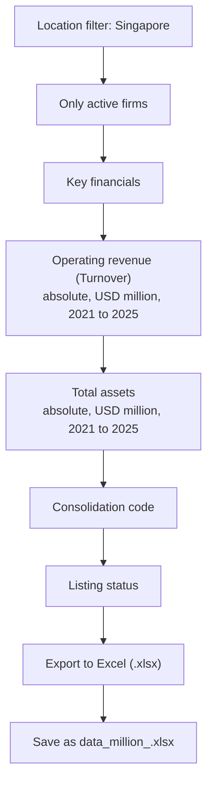

# Public vs Private Firm Size in Singapore

A DS607: Data Science for Economics group project comparing the financial size of publicly listed and privately held Singaporean companies from 2021 to 2025.

## Project motivation

Public and private companies may differ substantially in scale, access to capital, and financial structure. This project examines whether their revenue and total-asset distributions differ in Singapore and estimates the size of the annual gap between the two groups.

## Research question

Do the operating revenue and total-asset distributions of public and private Singaporean companies differ from 2021 to 2025?

For each year and financial measure, we estimate the difference between the public and private median and construct a 95% bootstrap confidence interval.

## Group members

- Madhurima S Rudra
- Nehantha Sathesh
- Paavas Bansal

## Data source

The project uses company-level data from the Orbis database. The analysis focuses on:

- Operating revenue (turnover)
- Total assets
- Singaporean companies
- Years 2021 to 2025
- Listed and unlisted companies

## Getting the data



## Method

The analysis proceeds as follows:

1. Clean the company-level financial data and document missing, zero, and negative values.
2. Keep Singaporean firms classified as listed or unlisted.
3. Reshape the source data into a company-year dataset.
4. Generate descriptive tables, ECDF and box plots for each public and private financial measure.
5. Run two-sample Kolmogorov-Smirnov tests to assess whether the public and private financial distributions differ.
6. Calculate annual public-minus-private median differences.
7. Use bootstrap resampling with a fixed random seed to construct 95% confidence intervals for the median differences.


## Outputs

The project produces:

- Descriptive statistics showing usable sample sizes and annual medians by group
- KS test statistics and p-values for revenue and total assets
- KS statistic (D) trend by year for revenue and total assets
- Annual median differences with 95% bootstrap confidence intervals
- Distribution plots for public and private firms
- Line charts of annual group medians
- Confidence-interval plots of annual median differences

## Repository structure

```text
.
├── notebooks/
│   ├── Wrangle_&_Tests.ipynb
│   └── Generating_outputs.ipynb
│
├── data/
│   ├── raw/                    # Original dataset; excluded from Git
│   └── processed/              # Cleaned data and analysis tables; excluded from Git
│
├── outputs/
│   ├── figures/                # Report-ready charts
│   └── tables/                 # Report-ready statistical tables
│
├── requirements.txt            # Python package requirements
├── AI_USAGE.md                 # Declaration of generative-AI use
├── CONTRIBUTIONS.md            # Group-member contributions
├── .gitignore
└── README.md
```

## Running the project

1. Create and activate a Python environment.
2. Install the required packages:

   ```bash
   pip install -r requirements.txt
   ```

3. Place the raw dataset in `data/raw/`.
4. Run `notebooks/Wrangle_&_Tests.ipynb` to clean the data, run the statistical tests, and create processed results.

## Data availability

The `data/raw/` and `data/processed/` folders are excluded from Git. This is to prevent uploading licensed ORBIS data into a public platform.

## Reproducibility

Bootstrap resampling uses a fixed random seed so that results can be reproduced when the same input data and code are used.

## AI use and contributions

See [AI_USAGE.md](AI_USAGE.md) for the group’s generative-AI declaration and [CONTRIBUTIONS.md](CONTRIBUTIONS.md) for individual contributions.
